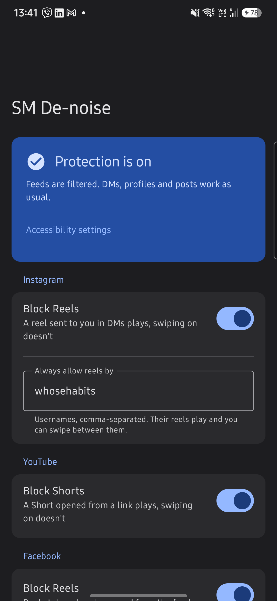

# SM De-noise

Social media without the endless video feeds. An Android app that keeps Instagram, Facebook and YouTube useful for staying in touch with friends and watching things you chose, and gets you out of Reels and Shorts.

## Why

I wanted to use social media for messages from friends and for meaningful YouTube videos, not to lose an evening to Reels. Apps that block whole apps were too blunt: I'd lose my DMs too. So this one only blocks the feeds.

## What it does

| App | Blocked | Still works |
|---|---|---|
| Instagram | Reels tab, reels in Explore, swiping on to the next reel | Feed, DMs, Stories, profiles; a reel a friend sent you in DMs plays |
| YouTube | Shorts tab, Shorts feed, swiping on to the next Short | Everything else; a Short opened from a link in another app plays |
| Facebook | Reels tab, reels opened from the feed | Feed, groups, profiles |
| TikTok | After a daily time budget (default 10 min) | Until the budget is used up |

You can also list Instagram accounts whose reels always play (for example your own, if you post reels for work).

## How it works

It's an Android [accessibility service](https://developer.android.com/guide/topics/ui/accessibility/service): it reads the structure of what's on screen (view ids and labels, not pixels) and presses Back when a Reels or Shorts screen opens. Everything happens on the phone. Nothing is stored or sent anywhere, and the app has no internet permission.

The tricky parts were telling feeds apart from the screens you want to keep, for example:
- Instagram keeps hidden screens in memory, so only views actually visible count.
- Inside Instagram, "reel" means Stories; the Reels feed is called "clips".
- Facebook barely labels its views, so its reels player is found by accessibility descriptions.
- "Someone sent you this video" is recognised by the sender bar in Instagram, and on YouTube by the app you came from.

## Install

There's no Play Store release: you build it yourself with Android Studio.

1. Install Android Studio. File > Open > select this folder, let Gradle sync.
2. On your phone: Settings > About phone > tap Build number 7 times > Developer options > enable USB debugging. Plug in via USB.
3. Pick your phone in the device dropdown, press Run.
4. Open SM De-noise > "Open accessibility settings" > Installed apps > SM De-noise > turn on.
   - If the toggle is greyed out ("Restricted setting"): Settings > Apps > SM De-noise > ⋮ menu > Allow restricted settings.

Once installed, the app stays on the phone; you can turn developer options off again.

## If blocking stops working after an app update

Instagram, Facebook and YouTube rename internal view ids from time to time. Turn on Debug logging in the app, open the Reels/Shorts screen, run `adb logcat -s SocialGuard`, and add the new ids to the lists at the top of [`BlockerService.kt`](app/src/main/java/app/socialguard/BlockerService.kt).

## Notes

- The code still says `socialguard` (package name, log tag): that was the app's first name. The package name stayed so an update installs over the existing app instead of next to it.
- Built with [Claude Code](https://claude.com/claude-code) in a day, tested on my own phone with the English and Ukrainian versions of the apps.
- A personal project, not affiliated with Meta, Google or TikTok. Use at your own risk.

## License

[MIT](LICENSE)
